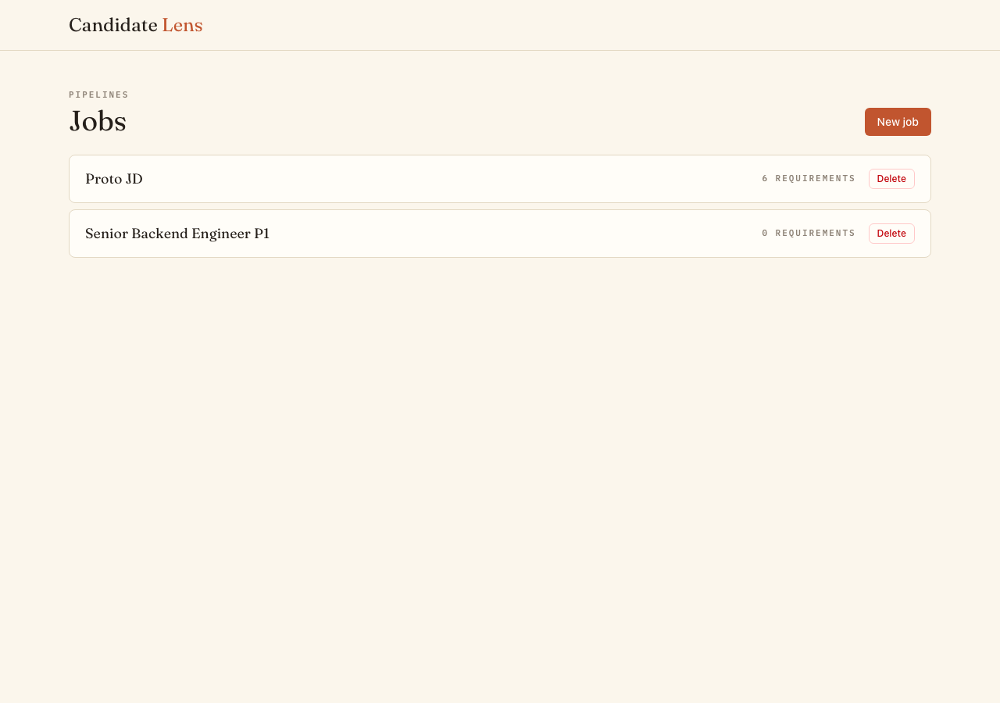
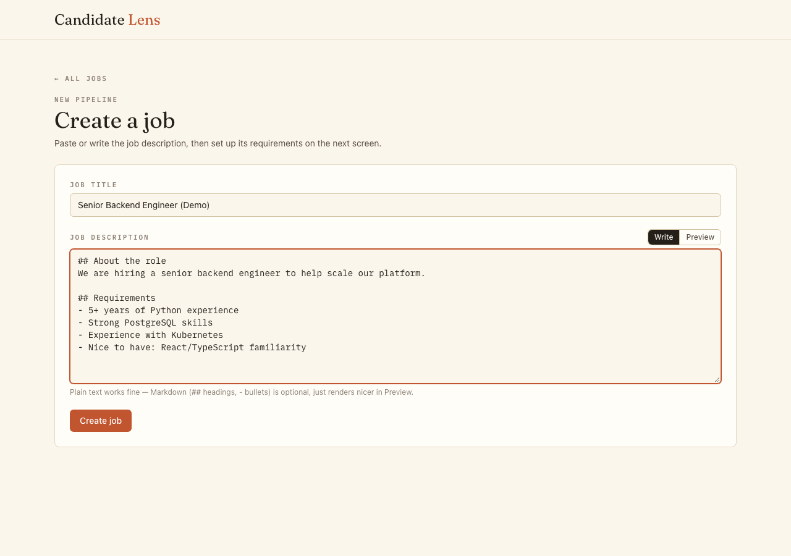
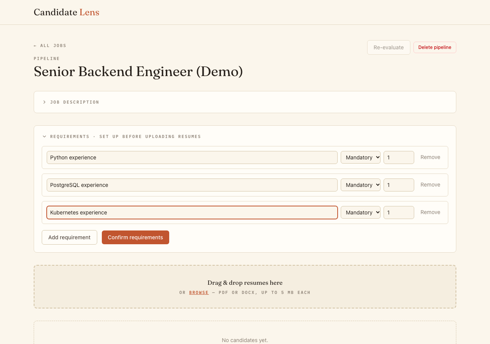
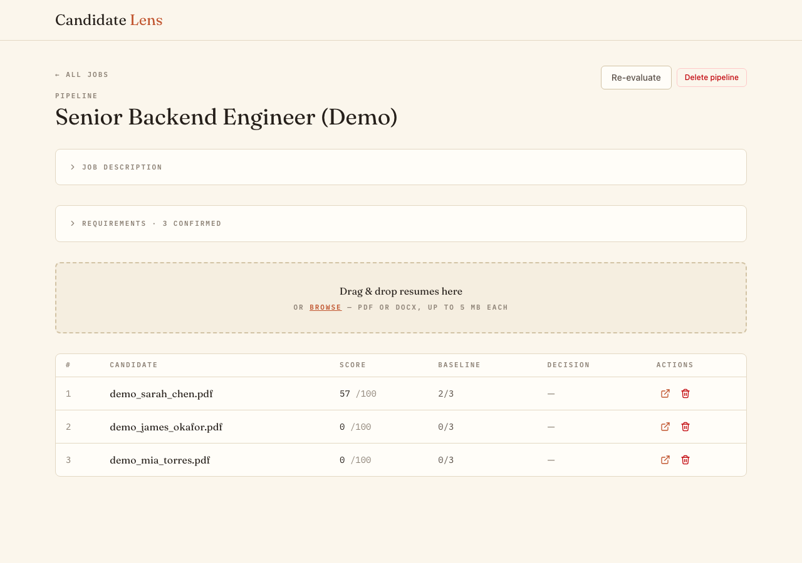
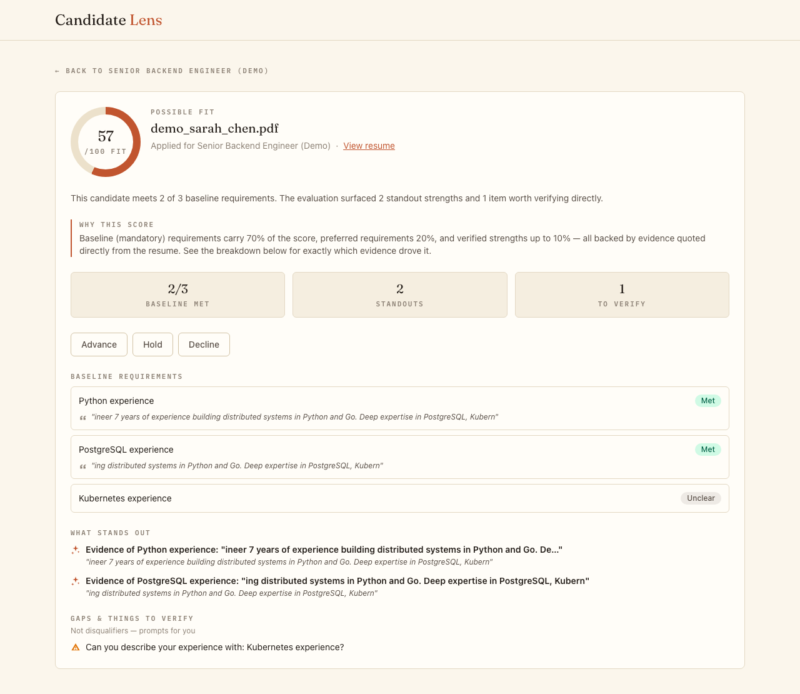

# CandidateLens

CandidateLens is an AI-assisted hiring workspace. A hiring manager pastes a
job description, sets up a rubric, and uploads resumes; the app tells them,
per candidate: whether the baseline requirements are met, what stands out,
and an overall fit score — every claim backed by evidence quoted directly
from the resume, with a human always in control of the actual decision.

A React/TypeScript frontend, a FastAPI backend, and a PostgreSQL database
with the full domain schema managed through Alembic migrations.

## Screenshots

**Job list**



**Create a job from a Markdown description**



**Set up the requirements rubric**



**Candidate board after uploading resumes**



**Candidate evaluation — fit score, evidence, standouts, gaps**



## What it does

- **Job setup.** Title + a Markdown (or plain-text) job description, with a
  Write/Preview toggle.
- **Requirements rubric.** Mandatory and preferred requirements, each with a
  weight. Build it by hand, or generate a draft from the job description and
  edit it. Requirements can be edited after candidates already exist — doing
  so wipes and redoes every evaluation against the new rubric, so stale
  scores against an old rubric are never left sitting around.
- **Resume upload.** Drag-and-drop or browse, `.pdf`/`.docx`, up to 5 MB each,
  up to 500 files per upload. Processing (validation, text extraction,
  dedup-by-content-hash, storage) runs as a background task — the UI shows
  live progress and any per-file failures (corrupted file, wrong format,
  decompression-bomb guard, etc.) without blocking on the whole batch.
- **Preliminary evidence matching.** The moment a resume finishes
  extraction, it's checked against the confirmed requirements with
  deterministic keyword matching — free, instant, no AI call. It can only
  confirm presence of evidence, never absence: an unmatched requirement is
  `unverified`, not a failure.
- **Deep AI evaluation.** Triggered per candidate (or for the whole pipeline
  via "Re-evaluate"), this is what actually answers the three questions in
  the brief: baseline requirements met, noteworthy strengths, and an overall
  fit score out of 100. Every quote the model returns — evidence and
  strengths alike — is independently re-verified as a real, exact substring
  of the resume text before being trusted; anything that doesn't verify is
  dropped. This is also the prompt-injection defense: text embedded in a
  resume can influence what the model says, but can't manufacture evidence
  that survives the independent check.
- **Candidate board.** Every application for a job in one sortable table:
  score, baseline requirements met, and the hiring manager's own decision.
- **Candidate evaluation panel.** Fit gauge, a plain-language "why this
  score" explanation, baseline/preferred requirement evidence, standout
  strengths, and gaps worth asking about directly — framed as prompts for
  the human, never as disqualifiers. Advance / Hold / Decline is a separate,
  explicit action the AI never touches and never influences.

## Project structure

```text
candidate-lens/
├── frontend/   React + TypeScript + Vite + Tailwind CSS
│   └── src/features/
│       ├── jobs/        job list/create/detail, Markdown preview, requirements editor
│       ├── resumes/     upload form + background-batch progress polling
│       └── candidates/  candidate board table and the evaluation panel
│           └── components/panel/   fit gauge, requirement evidence, standouts, gaps, decisions
├── backend/    FastAPI + SQLAlchemy + Alembic (Python 3.12)
│   ├── app/models/        SQLAlchemy domain models
│   ├── app/services/      upload orchestration (incl. background batch processing),
│   │                      preliminary matching, scoring, candidate pool queries,
│   │                      AI evaluation orchestration + caching
│   ├── app/integrations/  AI provider abstraction (OpenAI + deterministic mock),
│   │                      prompt construction, evidence verification
│   └── alembic/           Database migrations
├── examples/sample_job.md   Paste-ready job description + requirements for a demo
├── docs/screenshots/         Screenshots used in this README
├── compose.yaml  Local PostgreSQL via Docker Compose (alternative to a local install)
└── .env.example
```

## Prerequisites

- Node.js 20+ and npm
- Python 3.12+
- PostgreSQL 16, reachable at `localhost:5432` — either a local install
  (e.g. `brew install postgresql@16`) or `docker compose up -d` using the
  included `compose.yaml`

## 1. Start PostgreSQL

Using a local install:

```bash
brew services start postgresql@16
createuser -s candidatelens      # one-time
createdb -O candidatelens candidatelens
createdb -O candidatelens candidatelens_test   # used by the backend test suite
```

Or with Docker instead:

```bash
cp .env.example .env
docker compose up -d
```

Either way, credentials should match `DATABASE_URL` in `.env.example`
(`candidatelens` / `candidatelens`).

## 2. Run the backend

```bash
cd backend
python3.12 -m venv .venv
source .venv/bin/activate
pip install -e ".[dev]"
alembic upgrade head
uvicorn app.main:app --reload --port 8000
```

Verify it's running:

```bash
curl http://localhost:8000/api/health
# {"status":"ok","database":"ok"}
```

If PostgreSQL isn't reachable, `database` reports `"error"` instead of
failing the whole request — the backend distinguishes "the API is up" from
"the database is reachable."

Backend configuration is read from environment variables (see
`backend/app/core/config.py` and the root `.env.example`). Lint with
`ruff check app tests`; run the test suite with `pytest` (173 tests —
applies migrations to `candidatelens_test` automatically and rolls back
every test's changes, so it never touches the dev database).

### AI evaluation provider

By default `AI_PROVIDER=mock` — a deterministic, credential-free provider
that reuses the same keyword-matching engine as preliminary evaluation, so
its evidence is always genuinely grounded in the resume text (never
fabricated), and is clearly labeled as a mock in its output. This is what
the automated test suite always uses; no test makes a real API call.

To use real OpenAI evaluation instead, set in `backend/.env` (never commit
this file — it's already in `.gitignore`):

```bash
AI_PROVIDER=openai
OPENAI_API_KEY=sk-...
OPENAI_MODEL=gpt-4o-mini   # optional, this is the default
```

Every AI evaluation is cached by a hash of (resume content, job rubric
version, model, prompt version, scoring version) — re-requesting an
evaluation for unchanged inputs returns the cached result instead of calling
the API again.

The domain schema (`backend/app/models/`) is managed entirely through Alembic
migrations in `backend/alembic/versions/` — the app never creates tables on
startup.

## 3. Run the frontend

```bash
cd frontend
cp .env.example .env
npm install
npm run dev
```

Open the printed local URL (default `http://localhost:5173`). The app shell
shows a live connectivity badge confirming it can reach the backend's health
endpoint, read from `VITE_API_BASE_URL`.

Lint with `npm run lint`; format with `npm run format`; type-check and
production-build with `npm run build`.

## Using the app

1. Open the frontend and click **New job** — fill in a title and a Markdown
   (or plain-text) job description, with a Write/Preview toggle to check the
   rendering before submitting. `examples/sample_job.md` has a ready-to-paste
   title, description, and matching requirements if you'd rather not write
   your own.
2. On the job's page, set up requirements: build the list manually, or
   generate a draft from the job description and edit it before confirming.
   Requirements can be edited later too — doing so wipes and redoes every
   existing evaluation against the new rubric in the same request.
3. Upload one or more resumes (`.pdf` or `.docx`, 5 MB max each). Upload
   processing runs in the background with a live progress indicator; files
   are validated, stored under `backend/storage/resumes/` with a generated
   name (never the original filename), and text is extracted. Corrupted,
   encrypted, or scanned (image-only) documents are reported as failed
   per-file, with the reason, rather than failing the whole batch silently.
4. Every successfully extracted resume is automatically checked against the
   job's confirmed requirements using deterministic keyword matching — no AI
   involved yet. A requirement is `met` when explicit evidence is found in
   the resume text, or `unverified` otherwise; keyword absence is never
   treated as a failed requirement, since the matcher can only confirm
   presence, not proficiency.
5. The candidate board lists every application for the job — score,
   baseline requirements met, and decision. Click the view-score icon on any
   row to open its full evaluation.
6. From a candidate's page, trigger (or re-check) the deep AI evaluation.
   Every piece of evidence the AI provider returns is independently
   re-checked against the actual resume text before being trusted; anything
   that doesn't verify is downgraded or dropped, regardless of what the
   model claimed. The AI score can reach the full 100 (unlike the 90-point
   preliminary ceiling), since verified strengths unlock the remaining 10
   points. Advance / Hold / Decline there is the hiring manager's own call —
   it's never touched by running an evaluation, and running an evaluation
   never changes it.
7. "Re-evaluate" on the job page redoes both stages for every candidate
   against the current rubric and resumes in one action, and "Delete
   pipeline" removes a job and everything that exists only for it.

## Architecture notes and trade-offs

A few decisions worth knowing about if you're reading the code:

- **Evaluations are append-only and cached, not overwritten.** Every
  preliminary or AI evaluation attempt is its own row, keyed by a hash of
  (resume content, job rubric version, stage, model, prompt version, scoring
  version). Re-running with unchanged inputs returns the cached row instead
  of recomputing; changing the rubric, the resume, or the AI model
  invalidates the cache automatically because the hash changes. A unique DB
  constraint on that hash (not just an application-level check) is what
  actually prevents duplicate evaluation rows when two triggers race — see
  `backend/tests/test_evaluation_concurrency.py` for the proof, including a
  deliberate test of the race-recovery path, not just the happy path.
- **Preliminary matching never asserts `not_met`.** Keyword absence can't
  prove a skill is missing — only AI evaluation (with actual reasoning) can
  make that call, and only when there's explicit contradicting evidence.
  This is a deliberate guardrail against the system looking like it's making
  hiring judgments it has no basis for.
- **Every AI claim is independently re-verified.** The model's own evidence
  quotes are checked as exact (whitespace-normalized) substrings of the real
  resume text before being trusted — the model's say-so is never enough.
  This is also the actual prompt-injection defense: it doesn't matter
  whether the model got tricked by text embedded in a resume, because
  nothing ungrounded survives the independent check.
- **Resume upload runs as a background task**, not inline with the request —
  the batch is created immediately and processed (extraction, validation,
  storage, preliminary matching) off the request thread, with per-file
  results persisted so the frontend's progress view reflects real-time
  state. Deep AI evaluation, by contrast, still runs synchronously when
  triggered — fine per-candidate or for small batches, but a "re-evaluate
  everything" action against a very large candidate pool with a real
  (non-mock) AI provider would be a long-held request; backgrounding that
  the same way is the natural next step.
- **No task queue (Celery, etc.).** Background upload processing uses
  FastAPI's built-in `BackgroundTasks` — same process, no broker, no extra
  infrastructure. It doesn't survive a backend restart mid-batch, which is
  an acceptable trade-off for a single-instance deployment but worth
  knowing if this ever needs to run across multiple processes or machines.

## Current status

The full workflow described in "Using the app" above is implemented and
tested end to end: job setup, background-processed resume upload with real
PDF/DOCX extraction, deterministic preliminary matching, on-demand AI
evaluation with evidence verification, and the candidate board/evaluation
screen. 173 backend tests cover validation, extraction edge cases, scoring
math, evidence verification, prompt-injection resistance, caching, the
concurrency race condition described above, and background-task resilience;
the frontend has been manually verified against a live backend through the
entire journey from job creation to a reviewed, AI-evaluated candidate.
